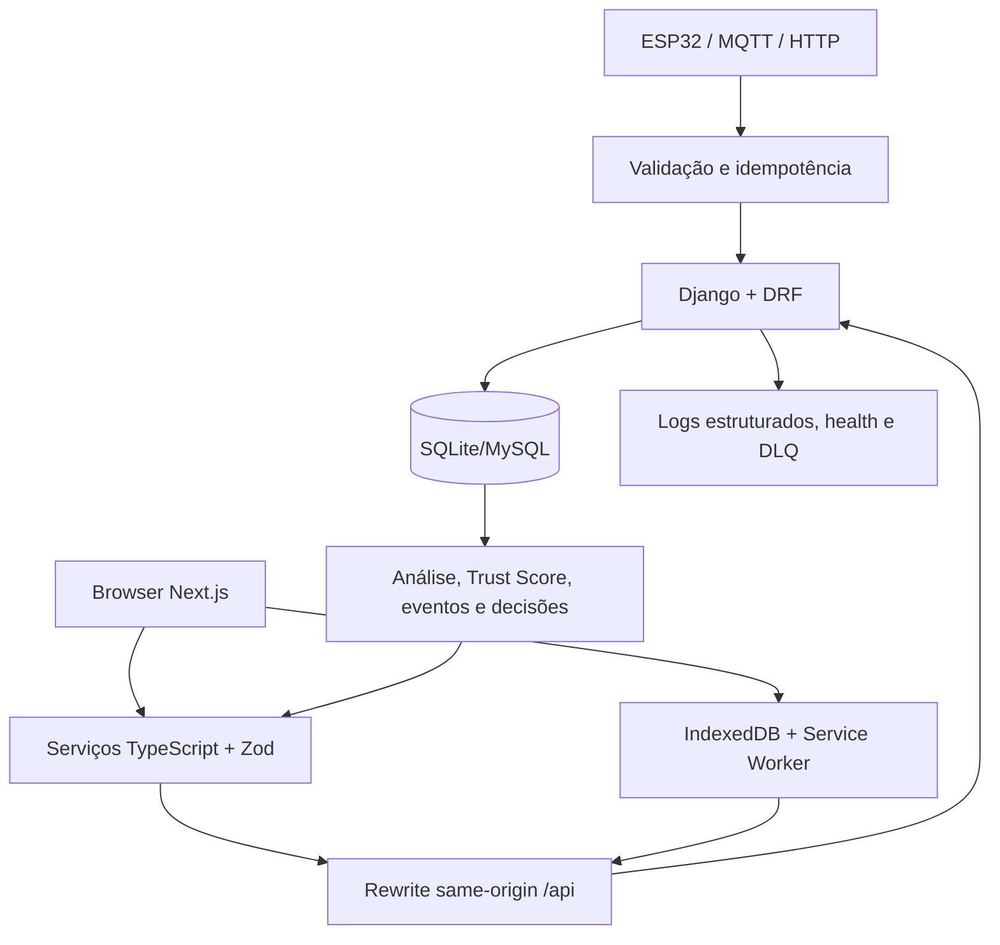

# Auditoria Final LEVIATÃ V2

**Data:** 15/10/2026  
**Branch:** `feature/merge-front-novo`  
**HEAD observado:** `3f72ab6cc50ca19cc7c690dcef2b1da2a9437d13`  
**Modo:** auditoria seguida de correções autorizadas  
**Escopo:** integração do `frontend-next` com o backend `api_tcc`, comparação com `frontfieldnode`, riscos do merge e validação local.

> A metodologia LEVIATÃ UNIVERSAL v3.0 foi lida a partir do anexo fornecido nesta sessão. A auditoria segue suas 25 seções, seus níveis de evidência e sua classificação P0 a P4.

## 1. Executive Summary

O merge atual é estruturalmente coerente: o backend canônico continua na raiz, o frontend ativo está em `frontend-next` e as rotas principais apontam para a API Django. A cópia `frontfieldnode` não deve ser tratada como segunda fonte canônica: ela é um repositório Git aninhado, contém uma revisão anterior do backend e não possui as migrações e serviços mais recentes da raiz.

O frontend atual preserva a linguagem visual e os componentes encontrados na cópia `frontfieldnode`, mas acrescenta correções de contrato, autenticação, estados e integração. Portanto, copiar a pasta histórica por cima causaria regressão.

O estado não pode ser declarado pronto para operação real. Há um bloqueio concreto na sincronização da outbox web: o navegador não envia mais a `X-API-Key`, corretamente, mas o backend exige essa chave para `POST /api/telemetria/`. A fila preserva o payload, porém não consegue concluir o reenvio até existir um mecanismo server-side autorizado.

Após a auditoria, foram corrigidos dois artefatos rastreados que ainda carregavam credencial literal ou endpoint obsoleto:

- `frontend-next/evidence.mjs` passou a exigir `FIELDNODE_AUTH_TOKEN` no ambiente e usa a chave de sessão atual.
- `scripts/simular_mqtt.py` e `scripts/stress_test.py` deixaram de possuir API key literal; o stress test passou a consultar `/api/health/`.

**Veredito:** `CONDITIONAL`, com bloqueio P1 conhecido para ingestão web e validação backend impedida pelo ambiente local, não por falha funcional demonstrada do código.

## 2. Project Discovery

### O que este projeto parece ser

Uma plataforma AgTech de telemetria e inteligência operacional para máquinas agrícolas, com ingestão HTTP/MQTT, histórico, análise de sinais, eventos, decisões e interface operacional.

### Problema resolvido

Transformar leituras de máquinas em contexto operacional, anomalias, indicadores de qualidade dos dados e recomendações revisáveis.

### Usuários aparentes

Operadores, responsáveis por manutenção e usuários administrativos de uma operação agrícola. O isolamento entre organizações existe parcialmente no modelo, mas não foi validado como requisito operacional completo.

### Stack identificada

| Camada | Tecnologias observadas |
|---|---|
| Backend | Python, Django 5.2, Django REST Framework |
| Frontend | Next.js 15, React 18, TypeScript, Tailwind CSS 4 |
| Dados | SQLite local, MySQL configurável |
| Ingestão | HTTP, MQTT, cliente de borda |
| Dados/ML | pandas, scikit-learn, Isolation Forest, Random Forest, regras determinísticas |
| Visualização | Recharts, Leaflet, React Leaflet, Lucide |
| Validação | Zod, testes Django, Playwright e scripts operacionais |
| Infraestrutura | Docker Compose, Gunicorn, Mosquitto e MySQL previstos |

### O que não foi possível determinar

Não há evidência nesta execução de carga real representativa, operação em máquina física, validação com MySQL ativo, autorização multi-tenant completa, rotação das credenciais antigas do histórico Git ou teste HTTP full-stack contra Django ativo.

## 3. Detected Technology Stack

As versões declaradas foram confirmadas em `requirements.txt`, `frontend-next/package.json`, lockfile e configurações. O lockfile do frontend foi alterado no working tree e precisa permanecer sincronizado com o manifesto.

Não foi adicionada dependência durante as correções desta auditoria.

## 4. Repository Structure

```text
api_tcc/                 domínio Django, modelos, serviços, API e testes
setup/                   settings, URLs, ASGI e WSGI
frontend-next/           frontend ativo do produto
  src/app/               rotas Next.js
  src/components/        componentes de interface
  src/services/          integração com a API
  src/schemas/           contratos Zod
  public/sw.js           fila offline e sincronização
scripts/                 simuladores, demonstrações e validações
simulators/              clientes de borda e testes de resiliência
docs/                    contratos, decisões, protocolos e auditorias
artifacts/               evidências e resultados históricos
frontfieldnode/          cópia histórica, com Git aninhado, não canônica
```

O arquivo `frontfieldnode/` é um repositório independente dentro do workspace. Ele deve ser tratado como fonte histórica/referência visual, não como diretório a ser incluído cegamente no repositório raiz.

## 5. Architecture Reverse Engineering



### Pontos fortes

- A regra de negócio de telemetria está separada da view e é reutilizada pelo fluxo MQTT.
- A idempotência possui suporte por identificadores de dispositivo e mensagem.
- O frontend valida respostas com schemas Zod antes de consumi-las.
- O rewrite same-origin reduz dependência de CORS no fluxo normal do browser.
- A fila offline preserva itens pendentes e não armazena respostas autenticadas da API.
- Eventos, decisões, DLQ e correlation IDs formam uma base razoável de diagnóstico.

### Pontos fracos

- A autenticação do dashboard usa `localStorage`, deixando o token acessível a JavaScript da origem.
- A ingestão web e a ingestão de dispositivo compartilham a rota, mas não o mesmo modelo de confiança.
- `frontfieldnode` cria ambiguidade operacional e pode ser incluído acidentalmente em um commit.
- Não há prova de execução full-stack atual após o conjunto de alterações do frontend.

## 6. Main Application Flows

### Login

1. `/login` coleta credenciais.
2. `authService.ts` chama `POST /api/auth/login/`.
3. O backend valida usuário e emite token DRF com expiração.
4. O frontend salva token e usuário localmente.
5. `SessionGate` redireciona respostas não autenticadas.

O fluxo foi validado estaticamente e possui evidência histórica de teste de interface simulada. Não foi validado contra servidor Django ativo nesta execução.

### Consulta operacional

1. Página Next chama `telemetryService`.
2. O serviço monta headers com `Authorization: Token` quando há sessão.
3. O rewrite envia a requisição ao Django.
4. Permissões filtram dados conforme sessão e modo demo.
5. Zod valida a resposta.
6. Componentes exibem loading, vazio, erro ou dados.

### Ingestão offline

1. O payload recebe `device_id` e `message_id`.
2. O Service Worker grava o item no IndexedDB.
3. O navegador tenta sincronizar `/api/telemetria/`.
4. O backend exige `X-API-Key`.
5. Como o browser não pode conter essa chave, o item permanece pendente.

Esse comportamento evita expor segredo, mas o fluxo ainda não está completo para ingestão iniciada no browser.

## 7. Critical Findings

| Severidade | Problema | Impacto | Local | Ação |
|---|---|---|---|---|
| P1 | Outbox web sem credencial aceita pelo backend | Reenvio de telemetria web não conclui | `frontend-next/public/sw.js`, `api_tcc/api/views_ingestao.py` | Criar fluxo server-side autenticado ou restringir oficialmente a outbox a dispositivos |
| P2 | Token em `localStorage` | XSS na origem pode capturar sessão | `frontend-next/src/services/authService.ts` | Migrar para cookie HttpOnly via BFF/proxy quando houver decisão de arquitetura |
| P2 | Execução backend local bloqueada | Não permite confirmar testes e contratos runtime | SciPy/sklearn no `.venv` | Corrigir ambiente ou executar em container limpo |
| P2 | Cópia Git aninhada e backend antigo | Risco de commit incorreto e divergência de fonte | `frontfieldnode/` | Manter fora do runtime e documentar como histórico, ou remover em decisão separada |
| P3 | Cadastro exibido, mas não implementado na API | Expectativa de produto não corresponde ao backend | `frontend-next/src/app/register/page.tsx` | Manter explicitamente informativo ou implementar contrato de cadastro completo |
| P3 | Ausência de teste HTTP full-stack atual | Contrato entre rewrite, Django e schemas não está provado | frontend/backend | Adicionar smoke tests com ambiente não produtivo |

## 8. Security Audit

### Confirmado

- O frontend atual não lê `NEXT_PUBLIC_FIELDNODE_API_KEY` para enviar a chave de ingestão.
- O Service Worker remove headers `X-API-Key` e `Authorization` de itens antigos da fila.
- A rota de ingestão valida `X-API-Key` no backend e aplica throttle no POST.
- O backend usa autenticação de token com expiração para o dashboard.
- A configuração tem headers de segurança básicos e CORS configurável.
- O arquivo de evidência deixou de conter token literal após a correção.

### Riscos restantes

- `localStorage` não é armazenamento adequado para uma sessão de alto impacto se a aplicação sofrer XSS.
- `DEMO_MODE` é uma fronteira de produto, não substituto de autorização de tenant.
- O histórico Git já foi apontado pela auditoria anterior como contendo credenciais antigas. A rotação/revogação remota não foi executada nesta tarefa.
- `.env.example` possui placeholders previsíveis. Eles não são segredo, mas não podem ser usados em ambiente real.

Não foi encontrada evidência de SQL construído por concatenação nos fluxos examinados. Não foi executada ferramenta especializada como Gitleaks.

## 9. Data / Database Audit

Há constraints, índices, chaves protegidas e migrations versionadas. A ingestão possui deduplicação e testes de concorrência. O desenho suporta SQLite local e MySQL configurável.

Riscos estruturais:

- O caminho de análise ainda possui dependências históricas em `LeituraTelemetria`, apesar da existência de modelos canônicos mais novos.
- Sem benchmark, não é possível afirmar comportamento do banco sob dez vezes mais leituras.
- O banco local `db.sqlite3` e backups são artefatos sensíveis e precisam de política clara de versionamento.
- A execução atual não confirmou migrações contra MySQL.

## 10. API / Contract Audit

| Domínio | Frontend | Backend | Estado |
|---|---|---|---|
| Login | `POST /api/auth/login/`, `Token` | Implementado | Compatível estaticamente |
| Máquinas | `GET /api/colheitadeira/` | ViewSet registrado | Parcial, sem HTTP atual |
| Posições | `GET /api/maquinas/posicao/` | View implementada | Parcial |
| Leituras | `GET /api/telemetria/`, `/leituras/ultimas/` | Views implementadas | Parcial |
| Ingestão browser | `POST /api/telemetria/` sem segredo público | Backend exige `X-API-Key` | Incompatível para browser |
| Operários | ViewSet e criação na UI | ViewSet registrado | Parcial |
| Prescrições | `/prescricoes/lista/` e por máquina | Rotas implementadas | Parcial |
| Relatórios | `/relatorio/` e exportação | Rotas implementadas | Parcial |
| Anomalias | Não há consumidor atual confirmado | Endpoint existe | Não integrado |
| Eventos/decisões | Não há fluxo completo atual confirmado | Rotas existem | Não integrado pela UI atual |

As respostas são protegidas por Zod em vários serviços, mas ainda não existe um normalizador único de erros para todos os domínios.

## 11. Frontend / Client Audit

O `frontend-next` atual é a melhor fonte de frontend encontrada. Ele possui rotas, componentes visuais, gráficos, mapa, estados de loading/erro/vazio, Service Worker, schemas e serviços. A comparação com `frontfieldnode/frontend-next` mostrou os mesmos blocos visuais relevantes, com diferenças no código de integração e segurança. A cópia histórica não deve substituir o frontend atual.

Pontos de atenção:

- A tela de cadastro tem apresentação completa, mas o submit informa que o backend não oferece cadastro. O estado de sucesso é código não alcançável no estado atual.
- A sessão expirada dispara evento e limpa o armazenamento local.
- A interface trata dados vazios, mas o comportamento full-stack com API indisponível não foi executado.
- O token continua em `localStorage`.
- O mapa e gráficos dependem de dados reais para confirmar casos de coordenada ausente, lista grande e payload parcialmente nulo.

## 12. Performance Audit

Não foram inventados números. A análise estrutural indica:

- Há índices e `select_related` em vários caminhos de consulta.
- O frontend evita cache de respostas `/api/` no Service Worker, reduzindo risco de dados autenticados stale entre usuários.
- O Service Worker usa `AbortController`/timeout no serviço TypeScript.
- Mapas, gráficos e listas grandes continuam candidatos a degradação com dez vezes mais máquinas, mas isso precisa de medição.
- O build local falhou por falta de memória do processo Node, portanto o custo real de bundle não foi medido nesta execução.

## 13. Testing Audit

Há uma suíte Django extensa, testes de identidade, autorização, concorrência, deduplicação, health, DLQ, decisões, análise e resiliência. Há também scripts de Playwright e testes de interface.

Lacunas:

- Não há teste de contrato HTTP atual cobrindo frontend real, rewrite e Django real em conjunto.
- A outbox web não possui teste que prove sincronização bem-sucedida com uma credencial server-side segura.
- O teste de expiração de sessão foi historicamente bloqueado quando o Django não estava ativo.
- A execução atual da suíte backend não produziu um recibo final utilizável, pois o processo foi encerrado antes da linha de conclusão observável.

## 14. DevOps / Infrastructure Audit

Docker Compose, MySQL, Mosquitto, Dockerfiles e configurações de ambiente estão presentes. Há instruções de execução e health check.

Não foi validado nesta execução:

- `docker compose up --build` completo;
- deploy check do Django;
- paridade entre SQLite e MySQL;
- rollback de release;
- pipeline CI remoto.

## 15. Observability Audit

O backend possui logs estruturados, correlation ID, health check e DLQ. Isso é uma boa base para investigação de falhas.

Ainda faltam métricas de negócio e operação, como taxa de rejeição, atraso da outbox, idade da última leitura por máquina e taxa de respostas 401/429/5xx. Sem essas métricas, incidentes de telemetria podem continuar exigindo investigação manual.

## 16. Documentation Audit

A documentação do domínio é acima da média do estado atual do código: existem contratos, protocolos, auditorias anteriores, documentação de honestidade metodológica de ML e registros de ensaio.

Divergências relevantes:

- O contrato frontend preserva uma visão histórica e possui adendo atual. O adendo deve ser considerado a parte vigente.
- Não há um roadmap único integral; a auditoria S10 reconstrói a conformidade a partir de vários documentos.
- A integração real ainda não possui um smoke test HTTP documentado como prova final.

## 17. Dependency Audit

As dependências principais são coerentes com a solução e não foi adicionada biblioteca durante as correções. O lockfile foi alterado no working tree e deve ser revisado junto com `package.json`.

O ambiente Python local apresenta falha de carregamento de DLL em SciPy. Isso é um problema de ambiente/reprodutibilidade que impede validação, mas não prova uma incompatibilidade intrínseca do código.

## 18. Technical Debt

| Dívida | Tipo | Impacto | Custo de atraso | Recomendação |
|---|---|---|---|---|
| Outbox web sem caminho autorizado | Segurança/estrutural | Telemetria web fica pendente | Alto se browser for produtor real | Decidir BFF autenticado ou retirar esse produtor |
| Token em `localStorage` | Segurança | Roubo de sessão em XSS | Crescente com usuários reais | Migrar para cookie HttpOnly com proteção CSRF |
| `frontfieldnode` aninhado | Estrutural/documentação | Fonte duplicada e commits acidentais | Médio | Formalizar como histórico ou retirar com decisão explícita |
| Contratos sem smoke HTTP | Testes | Falsa confiança entre camadas | Alto antes de release | Criar teste de integração não produtivo |
| Pipeline canônico incompleto | Estrutural/dados | Regras podem consumir modelo legado | Médio | Migrar incrementalmente e manter compatibilidade |
| Observabilidade sem métricas de fluxo | Infraestrutura | Diagnóstico lento | Médio | Instrumentar ingestão, outbox e latência |

## 19. Architectural Risks

O primeiro ponto provável de quebra com dez vezes mais carga é a ingestão e consulta histórica, não a camada visual isolada. A combinação de requisições síncronas, banco relacional único, análise e histórico precisa de medição antes de receber carga maior.

O segundo risco é a fronteira de confiança: uma API key de dispositivo não pode ser distribuída ao browser. A solução correta não é reintroduzir `NEXT_PUBLIC_FIELDNODE_API_KEY`.

O terceiro risco é operacional: duas árvores de projeto com Git próprio facilitam que alguém valide uma árvore e publique outra.

## 20. Detailed Findings Table

| ID | Sev. | Categoria | Local | Evidência | Problema e impacto | Causa | Ação | Risco se ignorado | Esforço | Confiança |
|---|---|---|---|---|---|---|---|---|---|---|
| FND-001 | P1 | Contrato/segurança | `sw.js:89-137`, `views_ingestao.py:166-176` | SW remove credenciais; backend exige chave | Outbox web não conclui sincronização | Dois produtores com modelos de confiança diferentes | Criar BFF autenticado, ou declarar outbox apenas para edge | Perda operacional aparente e fila crescente | 1 a 3 dias | Alta |
| FND-002 | P2 | Sessão | `authService.ts:59-60` | Token em `localStorage` | XSS pode capturar sessão | Escolha de sessão client-side | Cookie HttpOnly via camada server-side | Sequestro de conta | 2 a 5 dias | Alta |
| FND-003 | P2 | Validação | ambiente `.venv` | Import de SciPy falha por DLL/paginação | Backend não pode ser validado localmente | Ambiente incompleto/limitado | Recriar ambiente ou validar em container | Falsos negativos na aceitação | 0,5 a 1 dia | Alta |
| FND-004 | P2 | Repositório | `frontfieldnode/` | Git aninhado e revisão antiga | Merge futuro pode sobrescrever backend atual | Cópia histórica presente no workspace | Separar, arquivar ou ignorar formalmente | Drift e commit incorreto | 0,5 a 1 dia | Alta |
| FND-005 | P3 | Produto | `register/page.tsx` | API não registra rota de cadastro | Formulário parece funcional, mas não cria conta | Interface adiantada ao contrato | Tornar claramente informativo ou implementar API | Confusão de usuário | 0,5 a 2 dias | Alta |
| FND-006 | P3 | Testes | frontend/backend | Sem smoke HTTP atual | Compatibilidade só estática | Falta de ambiente integrado | Adicionar teste de contrato | Regressões tardias | 1 a 2 dias | Alta |
| FND-007 | P3 | Observabilidade | backend e SW | Logs existem, métricas de fluxo não | Incidente de fila é difícil de quantificar | Instrumentação incompleta | Medir atraso, taxa e idade de itens | Diagnóstico manual | 1 a 3 dias | Média |

## 21. Recommended Evolution Plan

### Etapa A, bloqueadores

1. Decidir se browser é produtor autorizado de telemetria. Se sim, criar endpoint server-side autenticado, com autorização do usuário e limites de payload. Se não, remover o caminho de envio web e documentar a outbox como edge-only.
2. Validar o backend em ambiente Python reproduzível, sem alterar o código para contornar a DLL.

### Etapa B, contratos

1. Criar smoke test login, máquinas, leituras, mapa, prescrições e relatório contra banco não produtivo.
2. Formalizar cadastro, logout remoto e identidade, ou remover a expectativa dessas telas.

### Etapa C, integridade

1. Medir e acompanhar itens pendentes da outbox.
2. Completar a migração gradual do pipeline legado para o modelo canônico.

### Etapa D, testes

1. Testar 401, 403, 429, timeout, payload inválido, duplicata e resposta paginada.
2. Testar Service Worker sem rede, rede restaurada e backend rejeitando autenticação.

### Etapa E, manutenção

1. Eliminar a ambiguidade de `frontfieldnode`.
2. Centralizar o tratamento de erro do frontend.

### Etapa F, evolução futura

1. Migrar sessão para cookie HttpOnly quando o BFF estiver definido.
2. Adicionar métricas e carga controlada.

## 22. Quick Wins

- Manter a correção dos scripts sem credenciais literais.
- Não incluir `frontfieldnode` no commit do repositório raiz.
- Executar `git diff --check`, lint, typecheck e teste de sintaxe antes de qualquer commit.
- Documentar no contrato que a outbox web está bloqueada até existir autorização server-side.
- Rotacionar credenciais expostas no histórico remoto, tarefa que depende do responsável pelo ambiente remoto.

## 23. Long-Term Improvements

- BFF ou sessão por cookie HttpOnly.
- Contrato OpenAPI gerado e verificado no CI.
- Testes de integração full-stack com dados efêmeros.
- Métricas de ingestão, atraso, qualidade dos dados e decisões.
- Particionamento/arquivamento histórico somente após medição de volume.
- Migração incremental para o modelo canônico sem big-bang rewrite.

## 24. Questions / Unknowns

- O browser deve realmente produzir telemetria, ou apenas exibir dados?
- `frontfieldnode` deve ser arquivado, removido ou preservado fora do repositório raiz?
- O token histórico encontrado na auditoria anterior ainda é válido? Isso exige revogação, não inspeção local.
- O requisito de cadastro existe ou a tela é apenas parte da direção visual?
- Qual ambiente reproduzível será usado para confirmar MySQL, Docker e os 285 testes históricos?
- Qual é o volume esperado de leituras por máquina e por organização?

## 25. Final Maturity Score

Escala da metodologia LEVIATÃ, de 1 a 10:

| Dimensão | Nota | Justificativa |
|---|---:|---|
| Arquitetura | 4 | Separação razoável, mas fronteira de ingestão web incompleta |
| Qualidade de código | 4 | Tipagem e serviços presentes; há código demonstrativo e caminhos incompletos |
| Segurança | 3 | Controles reais existem, mas sessão e histórico exigem ação |
| Dados | 4 | Constraints, deduplicação e migrations existem; pipeline canônico ainda parcial |
| API | 4 | Rotas e contratos documentados; integração runtime não comprovada nesta rodada |
| Desempenho | 3 | Há cuidados estruturais, mas não há medição atual de carga |
| Testes | 4 | Boa suíte histórica, porém validação full-stack atual é insuficiente |
| DevOps | 3 | Compose e Docker existem; deploy e rollback não foram verificados |
| Observabilidade | 4 | Logs, health, DLQ e correlation ID presentes; faltam métricas de negócio |
| Documentação | 5 | Contratos, protocolos e auditorias são extensos e úteis |
| Experiência de desenvolvimento | 3 | Workspace com Git aninhado e ambiente Python quebrado |
| Coerência de domínio | 4 | Conceitos de telemetria, confiança e decisão estão presentes |
| Manutenibilidade | 3 | Frontend grande e mudanças amplas ainda sem commit revisável |

**Maturidade geral:** aplicação funcional, porém imatura para operação real. Não é apenas uma tela demonstrativa, mas também não há evidência suficiente para classificá-la como preparada para produção.

### Autocrítica

- A metodologia foi aplicada sobre o código disponível e não sobre infraestrutura remota.
- A comparação com `frontfieldnode` é forte para estrutura e hashes, mas não prova comportamento visual em browser.
- O teste backend iniciou e executou casos, mas não houve recibo final observável nesta sessão; portanto não foi contado como aprovado.
- O build frontend foi tentado e falhou por falta de memória do processo Node durante execução concorrente; não é prova conclusiva de erro de compilação.
- Não foram executadas mudanças de banco, deploy, rotação de credencial ou limpeza destrutiva.
- A recomendação de BFF pode ser overengineering se o browser nunca for produtor de telemetria; a decisão deve partir do requisito real.

### Integridade da execução

As correções desta etapa foram limitadas a scripts de suporte e evidência. Nenhuma migration, dado, dependência de runtime ou regra de negócio do backend foi alterada. Não foi feito commit nem push.

