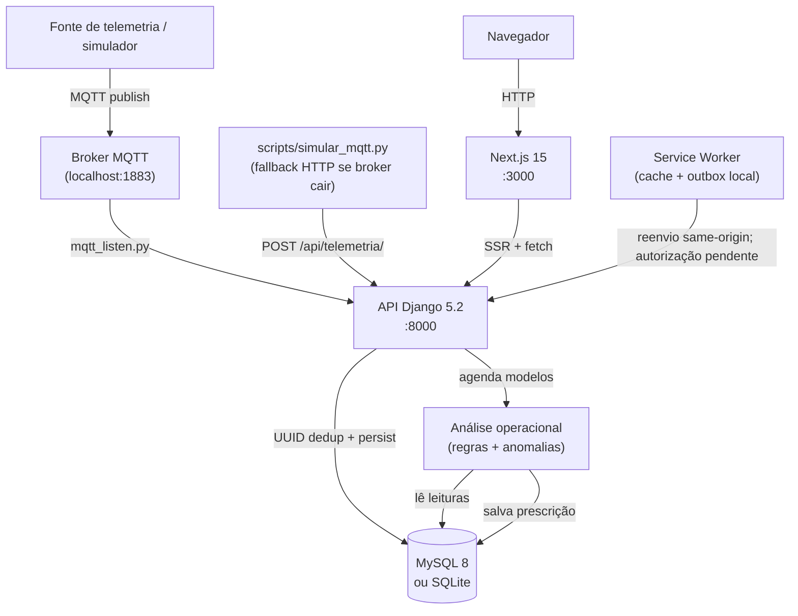
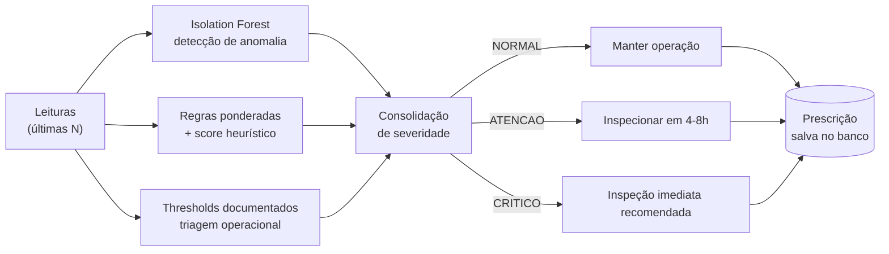

# FieldNode

Plataforma de telemetria e inteligência operacional para máquinas agrícolas.
Ingestão Django, dashboard Next.js, análise de anomalias e sincronização tolerante a falhas de rede rural.

---

## Arquitetura



---

## Pipeline de análise



---

## Stack

| Camada | Tecnologia |
| --- | --- |
| Backend | Django 5.2 + Django REST Framework |
| Frontend | Next.js 15 + React + Tailwind CSS |
| Banco | MySQL 8 em Docker / SQLite em desenvolvimento |
| Análise | Isolation Forest como sinal não supervisionado + regras/thresholds determinísticos |
| Hardware e transporte | Simuladores MQTT e cliente Python de bancada; ESP32/ESP-NOW permanecem como integração física a validar |
| Offline | Outbox SQLite no cliente Python e fila local IndexedDB no Service Worker |
| Docs API | Swagger em `/swagger/` |
| Testes | Django TestCase + pytest |

---

## O que está implementado

- ingestão HTTP autenticada por `X-API-Key`, validação de payload e deduplicação por UUID;
- persistência em SQLite/MySQL, com identidade de máquina, sequência, timestamp e hash no cliente de borda;
- cliente Python de bancada com outbox SQLite, prioridades A/B/C, retry, ACK e cursor contíguo;
- Trust Score heurístico e estado agregado de qualidade dos dados por máquina;
- geração determinística de eventos e decisões persistentes, com aprovação ou rejeição por usuário autenticado e registro de outcome;
- detecção de anomalias com Isolation Forest como sinal complementar, e regras ponderadas para triagem operacional;
- dashboard Next.js com service worker: cache de assets e fila local de telemetria sem credenciais privilegiadas;
- autenticação por token DRF com registro público, login, logout e verificação de sessão.

As evidências são de código, testes e bancada de software. As leituras usadas nas demonstrações são simuladas; isso não comprova sensor físico calibrado, operação em campo, execução mecânica ou resultado econômico.

## Roadmap

- integração física com ESP32 e sensores identificados, incluindo calibração e energia;
- medição de ESP-NOW ou outro transporte aprovado em bancada física;
- medição de retenção e capacidade de armazenamento de 30 dias no hardware-alvo;
- validação progressiva em campo, com alcance, estabilidade e condições registradas;
- avaliação de CAN/J1939, ISOBUS e integrações com fabricantes;
- dataset operacional rotulado e avaliação supervisionada de manutenção;
- evolução da autenticação do MVP para cookie httpOnly + CSRF.

---

## Execução com Docker (recomendado)

**Pré-requisito:** Docker instalado. Nenhum Python, MySQL ou Mosquitto local necessário.

### 1. Clonar e configurar variáveis

```bash
git clone <repositório>
cd fieldnode
cp .env.example .env
```

Edite o `.env` e preencha no mínimo:

| Variável | O que colocar |
| --- | --- |
| `SECRET_KEY` | Chave secreta Django |
| `FIELDNODE_API_KEY` | UUID para autenticação de ingestão |
| `DB_PASSWORD` | Senha do usuário MySQL |
| `DB_ROOT_PASSWORD` | Senha do root MySQL |

### 2. Subir os serviços

```bash
docker compose up --build
```

Aguarde os healthchecks: `db (healthy)`, `mosquitto (healthy)`, `web (healthy)`.

### 3. Executar migrations

```bash
docker compose exec web python manage.py migrate
```

### 4. (Opcional) Popular com dados de demonstração

```bash
docker compose exec web python manage.py popular_tudo
```

### 5. Acessar

| O quê | URL |
| --- | --- |
| API health | http://127.0.0.1:8000/api/health/ |
| Swagger | http://127.0.0.1:8000/swagger/ |
| Django Admin | http://127.0.0.1:8000/admin/ |

> O frontend Next.js é servido separadamente na porta 3000.
> Execute `cd frontend-next && npm ci && npm run dev` e configure
> `NEXT_PUBLIC_API_URL=http://127.0.0.1:8000/api` no `.env` do frontend.

### Comandos úteis

```bash
# Logs de todos os serviços
docker compose logs -f

# Logs só do worker MQTT
docker compose logs -f worker

# Status dos serviços e healthchecks
docker compose ps

# Entrar no container web
docker compose exec web bash

# Parar sem apagar volumes
docker compose down

# Parar e apagar volumes (inclusive banco — cuidado)
docker compose down -v
```

### Serviços

| Serviço | Descrição | Porta |
| --- | --- | --- |
| `web` | Django + Gunicorn | 8000 |
| `worker` | mqtt_listen (MQTT → banco) | — |
| `mosquitto` | Broker MQTT | 1883 |
| `db` | MySQL 8 | 3307 (host) |

### Testar fluxo MQTT

```bash
docker compose exec mosquitto mosquitto_pub \
  -h localhost -p 1883 \
  -t "fieldnode/COLH-01/leitura" \
  -m '{"id":"550e8400-e29b-41d4-a716-446655440001","maquina_id":"COLH-01","temperatura":78.5,"vibracao":0.42,"rpm":1850,"timestamp":"2026-10-06T12:00:00Z"}'

docker compose logs worker --tail=10
```

---

## Setup Local (sem Docker)

### Backend

```bash
python -m venv .venv
.venv\Scripts\activate        # Windows
# source .venv/bin/activate   # Linux/macOS
pip install -r requirements.txt
copy .env.example .env
python manage.py migrate
python manage.py treinar_isolation_forest
python manage.py runserver
```

O Isolation Forest é treinado offline com o cenário normal de bancada. O arquivo
`api_tcc/ia/modelos/isolation_forest_v1.pkl` acompanha o projeto; para regenerá-lo
de forma determinística, execute `python manage.py treinar_isolation_forest`.
Ele é um sinal não supervisionado complementar aos thresholds determinísticos.

### Frontend

```bash
cd frontend-next
npm ci
npm run dev
```

---

## Variáveis de Ambiente

Copie `.env.example` para `.env` e ajuste.

| Variável | Descrição |
| --- | --- |
| `SECRET_KEY` | Chave secreta Django |
| `FIELDNODE_API_KEY` | API key exigida no header `X-API-Key` |
| `DEMO_MODE` | Quando `True`, leitura pública anônima usa somente `Machine.is_demo=True` |
| `DEBUG` | `True` em dev, `False` em produção |
| `ALLOWED_HOSTS` | Hosts permitidos pelo Django |
| `CORS_ALLOWED_ORIGINS` | Origens permitidas pelo CORS |
| `NEXT_PUBLIC_API_URL` | URL da API usada pelo browser |
| `FIELDNODE_SERVER_API_URL` | URL da API usada pelo servidor Next |
| `USE_SQLITE` | `True` para SQLite em dev |
| `DB_NAME` / `DB_USER` / `DB_PASSWORD` / `DB_HOST` / `DB_PORT` | Conexão MySQL |

`FIELDNODE_API_KEY` pertence ao backend, scripts locais e dispositivos de ingestão.
O frontend não recebe segredo via `NEXT_PUBLIC_*`. O `.env` está no `.gitignore`.

---

## Rotas do Frontend

| Rota | Descrição |
| --- | --- |
| `/` | Redireciona para `/dashboard` |
| `/login` | Autenticação por token |
| `/register` | Cadastro público de usuário |
| `/dashboard` | Visão geral da frota: métricas, grid de máquinas, mapa |
| `/colheitadeiras` | Leituras recentes por máquina com badge de risco |
| `/detalhes?id=COLH-01` | Histórico, gráficos e prescrição da máquina |
| `/mapa` | Mapa de posição em campo |
| `/operarios` | Equipe cadastrada |
| `/maquinas` | Frota completa cadastrada |
| `/relatorios` | Geração de relatório JSON e exportação CSV |

---

## API — Endpoints principais

A documentação completa fica em `/swagger/`. Os endpoints mais relevantes:

| Endpoint | Método | Autenticação | Descrição |
| --- | --- | --- | --- |
| `/api/auth/login/` | POST | usuario/senha | Retorna token DRF |
| `/api/auth/register/` | POST | pública | Cadastro de usuário |
| `/api/auth/logout/` | POST | Token | Revoga token |
| `/api/auth/me/` | GET | Token | Perfil do usuário |
| `/api/health/` | GET | — | Health check da API e banco |
| `/api/telemetria/` | POST | `X-API-Key` | Ingestão com deduplicação UUID |
| `/api/leituras/ultimas/` | GET | Token / Demo | Última leitura por máquina |
| `/api/anomalias/` | GET | Token / Demo | Detecção de anomalias |
| `/api/manutencao/` | GET | Token / Demo | Análise preditiva de manutenção |
| `/api/events/` | GET | Token / Demo | Eventos priorizados |
| `/api/decisions/` | GET | Token / Demo | Fila de decisões |
| `/api/decisions/<uuid>/` | POST, PATCH | Token | Aprovação/rejeição de decisão |
| `/api/prescricoes/lista/` | GET | Token / Demo | Histórico de prescrições |
| `/api/relatorio/` | GET | Token / Demo | Relatório operacional |
| `/api/relatorio/exportar/` | GET | Token / Demo | Exportação CSV/XLSX |
| `/api/maquinas/posicao/` | GET | Token / Demo | Coordenadas GPS da frota |

Com `DEMO_MODE=True`, endpoints públicos de leitura retornam somente dados de `Machine.is_demo=True`.
Isso não libera escrita nem substitui autorização.

### Exemplo de ingestão

```bash
curl -X POST http://127.0.0.1:8000/api/telemetria/ \
  -H "Content-Type: application/json" \
  -H "X-API-Key: ${FIELDNODE_API_KEY}" \
  -d '{
    "id": "550e8400-e29b-41d4-a716-446655440000",
    "maquina_id": "COLH-01",
    "temperatura": 78.5,
    "vibracao": 0.42,
    "rpm": 1850,
    "latitude": -15.793889,
    "longitude": -47.882778,
    "timestamp": "2026-05-28T14:32:01Z"
  }'
```

Resposta `201`:

```json
{"status": "ok", "id": "550e8400-e29b-41d4-a716-446655440000", "ia": {"status": "agendado"}}
```

Reenviar o mesmo `id` retorna `200` sem duplicar o banco:

```json
{"status": "duplicata ignorada", "id": "550e8400-e29b-41d4-a716-446655440000"}
```

---

## Simulador MQTT

```bash
# MQTT normal
python scripts/simular_mqtt.py

# Forçar fallback HTTP (broker inacessível)
MQTT_PORT=1884 DEMO_CYCLES=1 python scripts/simular_mqtt.py
```

O simulador detecta `Connection refused`, entra em modo fallback e envia diretamente
para `/api/telemetria/`. O sistema não para — degrada com graciosidade.

---

## Testes

```bash
# Suite completa do backend
python manage.py test api_tcc

# Módulo específico
python manage.py test api_tcc.tests.test_telemetria --verbosity=2

# Fluxo end-to-end via scripts
python scripts/teste_fluxo_completo.py
```

Build e type-check do frontend:

```bash
cd frontend-next
npm run build
```

---

## Resiliência Offline

O Service Worker (`frontend-next/public/sw.js`) faz cache apenas de assets e mantém
payloads offline em IndexedDB. Respostas de `/api/` ficam na rede para não reutilizar
dados autenticados entre sessões. A fila remove headers de credenciais e preserva itens
quando a API rejeita a sincronização.

A ingestão operacional confiável é feita pelos clientes de dispositivo/borda (outbox SQLite
com retry, ACK e deduplicação). O service worker do browser é uma camada complementar de
resiliência, não substituta.

---

## Segurança — notas relevantes

- Token de autenticação fica em `localStorage` no MVP — dívida técnica explícita.
  Em produção, migrar para cookie `httpOnly` + CSRF adequado.
- `FIELDNODE_API_KEY` nunca deve entrar no bundle do frontend via `NEXT_PUBLIC_*`.
- Se uma API key anterior foi exposta no frontend, rotacione `FIELDNODE_API_KEY`
  no backend e nos dispositivos. Apagar o arquivo atual não reescreve o histórico Git.
- `DEBUG=False` e `ALLOWED_HOSTS` configurados antes de qualquer exposição pública.

---

## Licença

MIT
