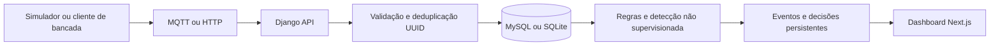

# FieldNode

Telemetria e inteligência operacional para máquinas agrícolas, com foco em um problema pouco glamouroso e muito real: dado atrasado, rede instável e alerta demais para pouca decisão.

O checkout atual prova software, testes e bancada. Ele não prova sensor calibrado, operação de campo, execução mecânica ou resultado econômico.

## O fluxo central



O caminho de uma leitura até uma decisão é rastreável: origem, timestamp, identidade, qualidade do dado, evento, recomendação e aprovação humana.

## Estado real

| Camada | O que existe | Limite atual |
| --- | --- | --- |
| Ingestão | HTTP autenticado por dispositivo, MQTT, validação e deduplicação | Ensaio físico depende de placa, sensor e credencial provisionados |
| Dados | MySQL no Compose e SQLite em desenvolvimento | Escala de produção ainda não foi medida |
| Borda | Cliente Python com outbox SQLite, ACK, retry e prioridades A/B/C | É bancada de software, não firmware embarcado validado |
| Análise | Regras/thresholds para triagem e Isolation Forest como sinal não supervisionado | Não é previsão validada de falha, RUL ou diagnóstico mecânico |
| Operação | Eventos e decisões persistentes com revisão humana | Utilidade em campo ainda precisa de dados e piloto |
| Hardware | Firmware e contratos PlatformIO presentes | Placa, rádio, gateway ESP-NOW e campo permanecem pendentes |

A matriz detalhada está em [`docs/CLAIMS_VS_CODE.md`](docs/CLAIMS_VS_CODE.md). O escopo de hardware está em [`docs/REPOSICIONAMENTO_ESCOPO_HARDWARE.md`](docs/REPOSICIONAMENTO_ESCOPO_HARDWARE.md).

Para a validação externa, consulte [`docs/PILOTO.md`](docs/PILOTO.md), [`docs/CARTA_DE_INTENCAO_MODELO.md`](docs/CARTA_DE_INTENCAO_MODELO.md) e [`docs/RESULTADOS_VALIDACAO_COMERCIAL.md`](docs/RESULTADOS_VALIDACAO_COMERCIAL.md). Esses arquivos separam material preparado de contato, autorização, piloto e evidência real.

## Arquitetura e stack

- Backend: Django 5.2, Django REST Framework e Gunicorn.
- Frontend: Next.js 15, React, TypeScript, Tailwind, SWR, Recharts e Leaflet.
- Transporte: Mosquitto/MQTT, HTTP e clientes de bancada.
- Análise: pandas, scikit-learn, regras determinísticas e metadados de modelo.
- Firmware: PlatformIO/ESP32, com validação host-side onde indicada nos relatórios.

O notebook é o hospedeiro da demo atual: Compose executa Mosquitto, Django, worker, banco e frontend. Hotspot ou LAN fornecem rede local; não são servidor nem internet automática. Veja [`docs/CONECTIVIDADE.md`](docs/CONECTIVIDADE.md).

## Quickstart local

Pré-requisito: Docker e Docker Compose.

```bash
git clone <repositório>
cd fieldnode
cp .env.example .env
docker compose up --build -d
docker compose exec web python manage.py migrate
```

Confira `http://127.0.0.1:8000/api/health/`, `http://127.0.0.1:8000/swagger/` e `http://127.0.0.1:3000/`. Para preparar a demo, use `make gateway-up` ou `make preflight`; ambos dependem de `.env` local e não criam segredo.

```bash
docker compose exec web python manage.py popular_tudo --username <usuario-cadastrado>
```

## Demonstração e evidências

- [`docs/ROTEIRO_DEMO_BANCA.md`](docs/ROTEIRO_DEMO_BANCA.md): sequência, preflight, fallback e registro de ensaios.
- [`docs/INVESTOR_CTO_PRESSURE_TEST.md`](docs/INVESTOR_CTO_PRESSURE_TEST.md): perguntas difíceis e respostas orientativas.
- [`docs/PITCH_FATOS.md`](docs/PITCH_FATOS.md): matriz que autoriza ou bloqueia claims do pitch.
- [`docs/evidence/`](docs/evidence/): relatórios de execução e limites.

Não há GIF versionado nem vídeo de fallback registrado neste checkout. A captura só deve entrar depois de existir arquivo real, com data e contexto.

## Segurança em linguagem simples

- Ingestão usa credencial individual de dispositivo; não há segredo global de produção por padrão.
- Segredos ficam fora do bundle do frontend e o `.env` está ignorado pelo Git.
- `DEMO_MODE` limita leitura pública a máquinas marcadas como demo.
- O MVP ainda usa token no `localStorage`; cookie `httpOnly` com CSRF é dívida explícita de produção.
- MQTT local sem TLS e a proteção contra extração física de credenciais ainda têm limites documentados em [`docs/SEGURANCA.md`](docs/SEGURANCA.md).

## Verificações úteis

```bash
python manage.py check
python -m pytest api_tcc/tests simulators
python scripts/check_docs_status.py
```

O resultado real de cada rodada deve ser registrado nos relatórios. Teste local não vira campo por osmose, por mais simpático que o terminal pareça.

## Roadmap explícito

- validação física de sensores, gateway, rádio, energia e armazenamento;
- três ensaios cronometrados e vídeo de contingência da demo;
- entrevistas estruturadas por papel e acesso a máquina para piloto;
- dataset operacional rotulado e avaliação de manutenção;
- TLS, cookie seguro, endurecimento de dispositivo e OTA assinada;
- validação progressiva em campo e integrações industriais autorizadas.

## Documentação

Comece por [`docs/CLAIMS_VS_CODE.md`](docs/CLAIMS_VS_CODE.md), depois leia os relatórios da tarefa que pretende defender. [`FIELDNODE_LEVIATA_ROADMAP_V5.md`](FIELDNODE_LEVIATA_ROADMAP_V5.md) descreve a visão e o roadmap; não substitui evidência de execução.

## Equipe

As contribuições e links abaixo vêm do cadastro tipado da interface e do relatório S3-T8:

| Pessoa | Frente | Links |
| --- | --- | --- |
| Vinícius Morales | Backend e IA | [GitHub](https://github.com/ViniciusMorales) · [LinkedIn](https://www.linkedin.com/in/vin%C3%ADcius-morales-609744368/) |
| Ana Furlaneto | Frontend e UI/UX | [GitHub](https://github.com/acfurlaneto) · [LinkedIn](https://www.linkedin.com/in/ana-furlaneto-a47746368/) |
| Giovana D'Angelo | Hardware e IoT | [LinkedIn](https://www.linkedin.com/in/giovanamdangelo/) |
| Paola Soares Machado | Full Stack e decisões | [GitHub](https://github.com/Paola5858) · [LinkedIn](https://www.linkedin.com/in/paolasoaresmachado/) |

Para contribuir, abra uma issue com o contexto, evidência e mudança proposta.
Antes de enviar código, rode os testes adequados e não inclua segredos. Ainda
não há um `CONTRIBUTING.md` separado; este fluxo é deliberadamente curto.

## Licença

MIT. Veja [`LICENSE`](LICENSE).
