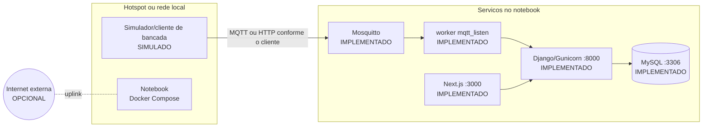
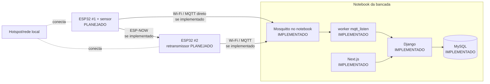
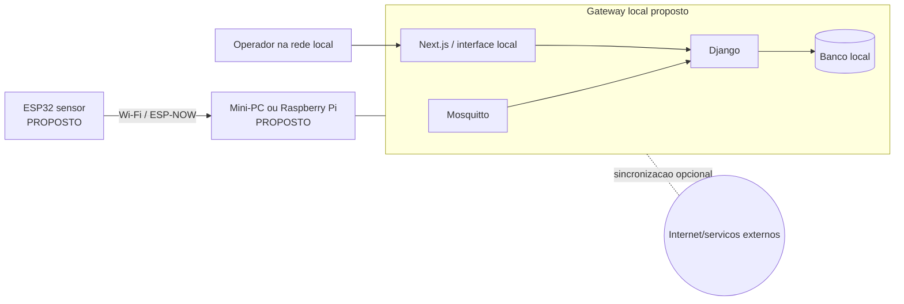

# Conectividade e topologia do FieldNode

Este documento separa a demonstracao executavel hoje, o prototipo de bancada
pretendido e a arquitetura de produto proposta. Um diagrama bonito nao cria um
gateway fisico; por isso cada capacidade abaixo esta marcada por estado.

## Matriz de auditoria

| Componente | Implementacao atual | Ambiente de execucao | Estado |
| --- | --- | --- | --- |
| ESP32 sensor | `firmware/` contem no sensor DS18B20 -> MQTT; ensaio fisico pendente | Placa ESP32, quando provisionada | SOFTWARE IMPLEMENTADO / BANCADA PENDENTE |
| ESP32 gateway | Nenhuma implementacao ESP-NOW encontrada | Nao aplicavel | ROADMAP |
| Broker MQTT | Mosquitto com password file, ACL e persistencia | Container `mosquitto` no notebook/host que executa Compose | IMPLEMENTADO |
| Backend Django | Gunicorn, API e `mqtt_listen` | Containers `web` e `worker` | IMPLEMENTADO |
| Frontend | Next.js 15 standalone | Container `frontend` ou processo local, conforme o modo de execucao | IMPLEMENTADO |
| Banco | MySQL 8 no Compose; SQLite em alguns cenarios de desenvolvimento | Container `db` ou processo local | IMPLEMENTADO |
| Cliente de borda | `simulators/edge_client.py`, com outbox SQLite e ACK | Processo Python de bancada | SIMULADO/BANCADA |

A matriz foi conferida contra `docker-compose.yml`, a configuracao do
Mosquitto, `README.md`, `simulators/edge_client.py` e `firmware/platformio.ini`.
O firmware do no sensor existe, mas isso nao prova placa, sensor ou gateway
ESP-NOW fisico.

## A. Demo atual: notebook como hospedeiro

Na demo, o notebook executa Docker e hospeda os servicos da aplicacao. O
Compose atual define:

- `mosquitto`: broker MQTT na porta 1883 dentro da rede Docker e publicado
  apenas em `127.0.0.1:${MQTT_HOST_PORT:-1883}`;
- `web`: Django/Gunicorn na porta 8000;
- `worker`: `python manage.py mqtt_listen`, consumindo o broker;
- `db`: MySQL 8, publicado no host em 3307 para diagnostico;
- `frontend`: Next.js na porta 3000.

O hotspot, quando usado, e somente a rede local que permite aos dispositivos
alcançarem o notebook. Ele nao e broker, backend, frontend nem conexao
automatica com a internet. O repositorio contem firmware do no DS18B20, mas
os fluxos fisicos ainda dependem de placa, sensor e credencial provisionados;
simuladores e clientes Python continuam disponiveis para bancada de software.

O diagrama usa o notebook como hospedeiro logico. A rede Docker interna liga
os servicos; as portas publicadas sao interfaces do notebook, nao servicos
executados pelo hotspot.

## B. Prototipo de bancada: ESP32 sensor, ESP32 retransmissor e notebook

Esta e uma topologia de bancada documentada como alvo de integracao, nao como
capacidade ja validada. O ESP32 #1 faria a aquisicao. Ele poderia publicar
MQTT diretamente quando tivesse Wi-Fi, ou enviar por ESP-NOW ao ESP32 #2.
Nesse segundo caminho, o ESP32 #2 faria apenas recepcao, validacao e
retransmissao para o broker no notebook.

Receber um quadro ESP-NOW, publicar MQTT, hospedar um broker, executar Django
e servir Next.js sao funcoes diferentes. O ESP32 #2 nao deve ser descrito como
servidor completo do FieldNode.

## C. Arquitetura de produto proposta

Na arquitetura de produto, um mini-PC ou Raspberry Pi pode atuar como
gateway-nucleo e hospedar localmente broker, backend, banco e frontend, se o
dimensionamento, armazenamento, seguranca e manutencao forem validados. Nenhum
modelo, memoria ou carga especifica e declarado aqui sem ensaio.

O gateway proposto nao e um ESP32. A proposta depende de validacao de
desempenho, persistencia, atualizacao, seguranca e operacao. Servicos externos
podem ficar indisponiveis sem uplink, enquanto a operacao local prevista pode
continuar se a pilha local estiver ativa.

## O que funciona sem internet?

Internet externa e diferente de rede local. Se o uplink cair, processos no
mesmo notebook e dispositivos na mesma LAN ainda podem se comunicar. Se o
notebook ou a LAN cair, o resultado muda completamente.

| Recurso | Demo no notebook | Prototipo de bancada | Produto proposto |
| --- | --- | --- | --- |
| Aquisicao de sensores | Conforme simulador; hardware fisico nao implementado | ESP32 #1, quando o firmware existir | ESP32 sensor |
| Comunicacao local | Rede Docker + LAN/hotspot | Wi-Fi ou ESP-NOW, conforme implementacao | Rede local do gateway |
| Broker MQTT | Notebook | Notebook | Gateway dedicado |
| Backend | Notebook | Notebook | Gateway dedicado, se implantado |
| Banco | Notebook | Notebook | Gateway dedicado, se implantado |
| Dashboard | Notebook | Notebook | Gateway dedicado, se implantado |
| Internet externa | Nao e necessaria para os processos locais | Nao e necessaria para o fluxo local previsto | Nao e necessaria para a operacao local prevista |
| Servicos externos | Indisponiveis sem uplink | Indisponiveis sem uplink | Indisponiveis sem uplink |

### Falhas relevantes

- Se o notebook desligar, broker, worker, backend, banco e dashboard da demo
  deixam de funcionar. Nao existe gateway fisico substituto no repositorio.
- Se apenas o uplink cair, os processos locais continuam, desde que a rede
  local e o notebook estejam ativos.
- Se o Wi-Fi/LAN local cair, clientes Wi-Fi nao alcancam o notebook. Um caminho
  ESP-NOW so poderia continuar se estivesse implementado e independente desse
  enlace; isso nao foi validado.
- Se o gateway proposto perder energia, seus servicos param. A recuperacao e a
  durabilidade dependem do armazenamento e da configuracao que ainda precisam
  ser validados.
- O `edge_client.py` possui outbox SQLite persistente e ACK para seu fluxo HTTP
  de bancada. O simulador MQTT nao guarda localmente publicacoes que falham.
  Isso nao prova outbox persistente em ESP32.
- Sincronizacao, servicos remotos, LLM em nuvem e qualquer replica externa
  dependem de uplink.

## Limite tecnico do ESP32

Um ESP32 pode servir uma pagina estatica pequena ou uma interface web simples,
respeitando memoria, armazenamento e processamento. Isso nao equivale a
executar o frontend Next.js completo do FieldNode, com suas rotas,
dependencias, visualizacoes e processamento. Tambem nao equivale a hospedar o
backend Django, o banco ou o broker MQTT.

Portanto, qualquer texto que descreva o ESP32 #2 servindo o dashboard principal
deve ser lido como incorreto. Uma pagina embarcada simples pode ser uma
possibilidade futura, mas nao substitui o frontend Next.js.

## Escopo e evidencias

O repositorio possui simuladores, cliente Python de bancada, Compose, servicos
locais e firmware PlatformIO para o primeiro no sensor. Nao possui ESP32
gateway, ESP-NOW fisico ou mini-PC/Raspberry implantado. A ausencia de internet externa nao transforma
essa implementacao em produto offline embarcado: hoje ela significa, na demo,
que o notebook pode manter os servicos locais enquanto estiver ligado.

Os testes de software e de Docker nao substituem ensaio fisico, alcance de
radio, armazenamento em flash, autonomia, energia ou operacao de campo.
