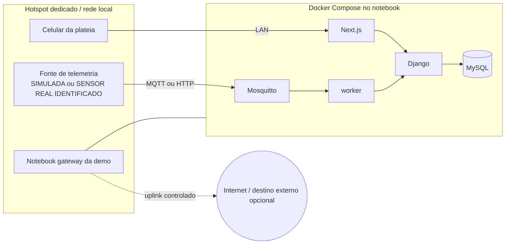

# S12-T3 - Roteiro da demo offline

Status: ROTEIRO ATUALIZADO; VALIDACAO OPERACIONAL PENDENTE.

## Tese da demonstracao

O notebook e o gateway local da apresentacao: ele hospeda o Docker Compose, o broker MQTT, o backend, o banco e o frontend. O hotspot fornece somente a rede local para o celular da plateia. Cortar o uplink externo nao deve derrubar a LAN nem os servicos no notebook.

Isso prova continuidade local da bancada. Nao prova gateway ESP32, Data Mule fisico, operacao de campo, sensor calibrado ou sincronizacao cloud. O destino cloud permanece indefinido por D-26; portanto, a religacao so pode ser narrada como sincronizacao quando houver um destino e uma evidencia reais.

## Dependencias e preflight

Antes da apresentacao:

1. Configurar o hotspot dedicado e anotar SSID, canal fixo e senha fora do roteiro publico.
2. Configurar `.env` sem exibir segredos. `DEMO_MODE=True` limita leituras anonimas a maquinas marcadas como demo; nao substitui autenticacao.
3. Subir o ambiente com `make gateway-up` ou `docker compose up -d --build`, seguido de migrations.
4. Rodar `scripts/preflight.sh` e guardar a saida do dia. Para testar o endereco previsto, configurar `FIELDNODE_PREFLIGHT_LOCAL_URL=https://fieldnode.local` e `FIELDNODE_PREFLIGHT_LOCAL_HOSTNAME=fieldnode.local` somente quando S13-T12 estiver implementado.
5. Confirmar que o video de fallback existe, abre no equipamento e tem data, arquivo e escopo registrados.

O preflight distingue `OK`, `WARN` e `FAIL`. `WARN` nao e prova de HTTPS, hostname, uplink ou sincronizacao. No checkout atual, HTTPS local/`fieldnode.local`, hotspot, corte de WAN preservando LAN e video ainda estao **NAO VERIFICADOS**.

## Roteiro cronometrado, aproximadamente 6 minutos

| Tempo | Acao | Evidencia que deve aparecer | Frase-limite |
| --- | --- | --- | --- |
| 0:00-0:30 | Explicar o problema em uma frase: uma decisao local nao deveria desaparecer porque o uplink caiu. | Estado inicial e preflight do dia. | Nao usar estatistica sem fonte. |
| 0:30-1:30 | Fonte publica telemetria; mostrar recepcao, persistencia e tela. Identificar se e sensor real provisionado ou simulador. | UUID, timestamp, origem e leitura no backend/dashboard. | Simulador nao vira sensor fisico por estar em cima da mesa. |
| 1:30-2:00 | Registrar o estado WAN, cortar apenas o uplink do notebook pelo procedimento previamente ensaiado e confirmar que o celular continua no hotspot. | WAN indisponivel e LAN ainda acessivel. | Nao desligar o hotspot nem o notebook. |
| 2:00-3:00 | Com a WAN cortada, abrir a aplicacao no celular e repetir a etapa local prevista. | Tela local, health ou evento local, com horario e origem. | So mostrar alertas realmente gerados pelo sistema. |
| 3:00-3:45 | Abrir a decisao pendente e mostrar evidencias, prioridade, qualidade/confianca conforme o contrato e estado da fila. | Registro persistente e estado pendente. | Score de anomalia nao e probabilidade de falha. |
| 3:45-4:30 | Aprovar a decisao com usuario autorizado e gerar OS apenas se o fluxo existir no ambiente. | Auditoria, estado e relacionamento decisao-OS. | Recomendacao nao executa intervencao mecanica. |
| 4:30-5:30 | Restabelecer o uplink. Mostrar backlog, ACK e sincronizacao somente se o destino estiver configurado e o resultado for observado. | Numeros desta execucao; ou declarar que cloud nao esta configurada. | S6-T5 esta pendente e nao fornece numeros reutilizaveis. |
| 5:30-6:00 | Encerrar com limites: Data Mule fisico, J1939/multimarca real, validacao de campo e sincronizacao cloud, quando pendentes. | Matriz de fatos e roadmap. | Honestidade nao e rodape; e parte da prova. |

## Procedimento seguro de corte

O operador registra `WAN_ON`, abre a aplicacao pelo endereco local e confirma o celular conectado ao SSID do hotspot. Depois usa o mecanismo previamente testado no sistema operacional para desabilitar somente a interface/uplink externo. Em seguida registra `WAN_OFF`, recarrega a pagina no celular e executa a etapa local.

Se a pagina deixar de abrir, o operador nao improvisa: registra se caiu WAN, LAN, DNS ou servico local, restabelece a conectividade e aciona o fallback. Nao usar chama, calor, curto, impacto ou desligamento de sensor para fabricar um evento.

## Fallback

O fallback e um video de uma execucao real, sem cortes que escondam falhas relevantes. Ao trocar, dizer: "vamos usar a gravacao de contingencia; ela mostra uma execucao anterior e nao uma execucao ao vivo". O video deve mostrar o mesmo fluxo e ter registro de data, versao do checkout, ambiente e limites.

## Ensaios e criterio de aceite

Tres execucoes consecutivas devem ser feitas com pessoa de fora do grupo operando o celular. Cada uma registra duracao, intervencoes fora do roteiro, falhas, estado WAN/LAN, resultado local e arquivo de evidencia.

| Ensaio | Data | Operador | Duracao | Intervencoes fora do roteiro | Resultado | Video |
| --- | --- | --- | ---: | ---: | --- | --- |
| E1 | NAO EXECUTADO | NAO REGISTRADO | NAO MEDIDA | NAO MEDIDO | PENDENTE | NAO REGISTRADO |
| E2 | NAO EXECUTADO | NAO REGISTRADO | NAO MEDIDA | NAO MEDIDO | PENDENTE | NAO REGISTRADO |
| E3 | NAO EXECUTADO | NAO REGISTRADO | NAO MEDIDA | NAO MEDIDO | PENDENTE | NAO REGISTRADO |

O criterio de aceite so fica cumprido com tres execucoes seguidas, sem intervencao externa ao roteiro, LAN preservada depois do corte e evidencia da terceira. Ate la, S12-T3 permanece parcial.

## Fontes e limites

- Topologia real: [`CONECTIVIDADE.md`](CONECTIVIDADE.md).
- Preflight: [`../scripts/preflight.sh`](../scripts/preflight.sh).
- Deploy local e cloud: [`DEPLOY.md`](DEPLOY.md). `cloud-up` permanece bloqueado sem provedor/destino.
- S6-T5: [`evidence/s6/S6-T5_EXECUCAO.md`](evidence/s6/S6-T5_EXECUCAO.md), sem rodadas oficiais nem numeros publicados.
- S10-T8: [`evidence/s10/S10-T8_REPORT.md`](evidence/s10/S10-T8_REPORT.md), sem deploy publico ou gravacao.
